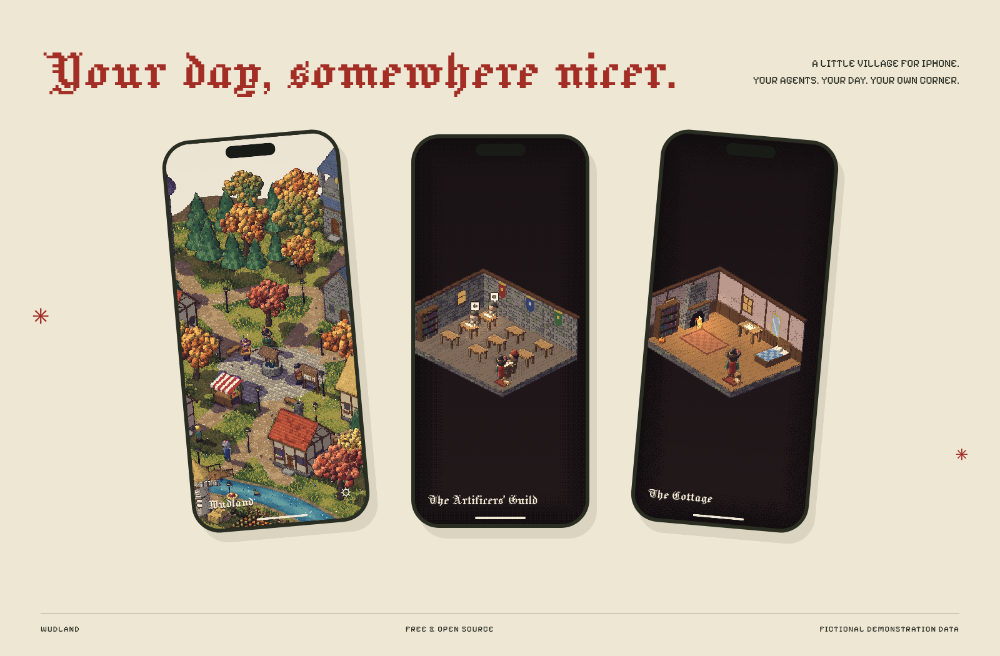

<p align="center">
  
</p>

<h1 align="center">Wudland</h1>

<p align="center">
  Your day, somewhere nicer.<br>
  A little pixel village for your iPhone, where your coding agents live as villagers.
</p>

<p align="center"><a href="https://wudland.netlify.app"><b>wudland.netlify.app</b></a> · <a href="https://github.com/joexk1/wudland-plugins">Wudland Link</a></p>



*Actual village engine, fictional demonstration agent data. Phone frames are presentation artwork.*

## Why a village?

I wanted a nicer way to see what was going on. A calendar doesn't have to be a grid. An agent doesn't have to be another tab. So I gave them somewhere to live.

Your agents work at the forge and gather in the Artificers' Guild. Letters arrive at the Raven Post. Your calendar and reminders are at the bell tower. There's a wizard to talk to, a cottage to furnish, and a few ducks that don't care about your deadlines.

Walk around. Drop in on someone. See what's happening. Put your phone away.

## What's here

- A procedural pixel village with interiors, changing daylight, seasonal colours, weather and wandering villagers.
- Coding agents as townsfolk: working, waiting, finished, or in trouble. The companion plugins support Claude Code, Codex, opencode and ordinary terminal commands.
- The Raven Post for letters from your scripts and tools.
- Calendar and reminders from your iPhone, with permissions you control.
- A wizard powered by Apple's on-device models on compatible devices, or an optional supported cloud model with your own API key and explicit cloud consent.
- Character customisation, cottage furnishings and a little village economy.
- Settings, village progress, letters, links and conversations kept between launches.

**iPhone duo mode — coming soon.**

## Release status

The first iPhone release is being prepared. This repository contains the source; an App Store link will be added when the app is available. Do not treat source availability as an App Store approval.

## Link your computer

The companion code is in **[wudland-plugins](https://github.com/joexk1/wudland-plugins)**, under the MIT licence.

```sh
npm i -g github:joexk1/wudland-plugins
wudland link 123456
```


If your npm version refuses GitHub packages with `EALLOWGIT`, allow this direct dependency for that command:

```sh
npm i -g --allow-git=root github:joexk1/wudland-plugins
```

Use the six-digit code in **Wudland → Settings → Link a computer**, not the example above. It refreshes every 60 seconds. Compare the separate eight-digit verification code on the phone and computer, then approve the connection. This prevents a relay from silently swapping the pairing keys.

Install the integration for your agent, then run `wudland test-send` to welcome your first neighbour. See the companion README for Claude Code, Codex and opencode setup.

## Your data

There is no Wudland account or Wudland-operated backend. Calendar and reminders are read on the phone after permission. Saved secrets use the iOS Keychain.

Agent events and letters are encrypted with AES-256-GCM before they leave your computer. Pairing uses X25519, HKDF-SHA256 and a code you compare on both devices. Messages travel through an ntfy-compatible relay; the default is ntfy.sh, and you can use your own. The relay can see IP addresses, timing and pairing announcements, including computer labels and public exchange keys. It cannot decrypt the agent events or letters without their link key.

Agent titles may include the first 60 characters of a prompt. To keep titles and file names out of updates:

```sh
wudland config titles off
```

Weather requests send rounded location coordinates, or your entered town, to Open-Meteo. Optional cloud wizard requests go directly to your selected provider and include recent wizard conversation messages. Calendar, reminders, location, letters and agent data are not attached to wizard requests. Provider charges and terms apply.

## Build it

You need a Mac with Xcode 26 or newer, an iOS 26 SDK, and [XcodeGen](https://github.com/yonaskolb/XcodeGen).

```sh
brew install xcodegen
xcodegen generate
open Wudland.xcodeproj
```

Choose your signing team and a unique bundle identifier before running on your iPhone. The project leaves the signing team unset so you can use your own Apple developer account.

For a simulator build:

```sh
xcodebuild -project Wudland.xcodeproj -scheme Wudland \
  -sdk iphonesimulator -configuration Debug CODE_SIGNING_ALLOWED=NO build
```

Permissions are optional. A denied permission leaves that source unavailable; it does not prevent you from exploring the village. On-device wizard support depends on device capability and Apple Intelligence availability.

## Inside

```text
Wudland/
  App/           application and village UI
  Local/         permissions, local data, linking, wizard and storage
  Village/       state models and economy
  Talk/          conversations and villagers
  Game/          SwiftUI ↔ WebKit bridge
  Web/           procedural pixel world, rendering and interaction
  UI/            native sheets, theme and sound
  Resources/     bundled fonts
```

The world is drawn by the bundled JavaScript engine inside a WKWebView. The surrounding app uses SwiftUI, EventKit, CoreLocation and CryptoKit.

## Bugs and ideas

[Open an issue](https://github.com/joexk1/wudland/issues). Please remove private calendar details, messages, API keys, app codes and computer link files from anything you post.

## Licence

GPL-3.0. See [LICENSE](LICENSE). The companion plugins are MIT-licensed so you can use the tools in your own projects. The renderer includes work based on Pixel Plays under its MIT licence. Jacquard 12 and Pixelify Sans are bundled under the SIL Open Font License. Their full notices are preserved in [THIRD_PARTY_LICENSES](THIRD_PARTY_LICENSES) and bundled in the app.
