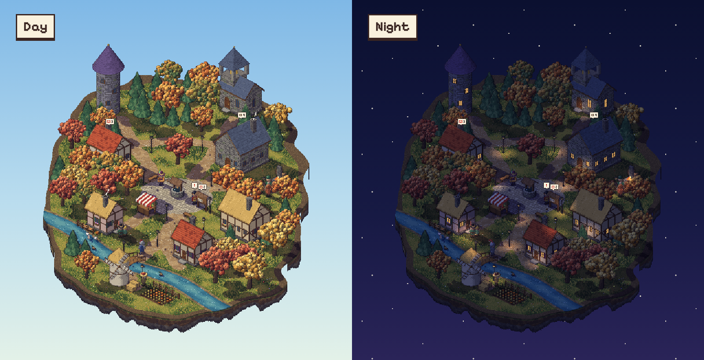
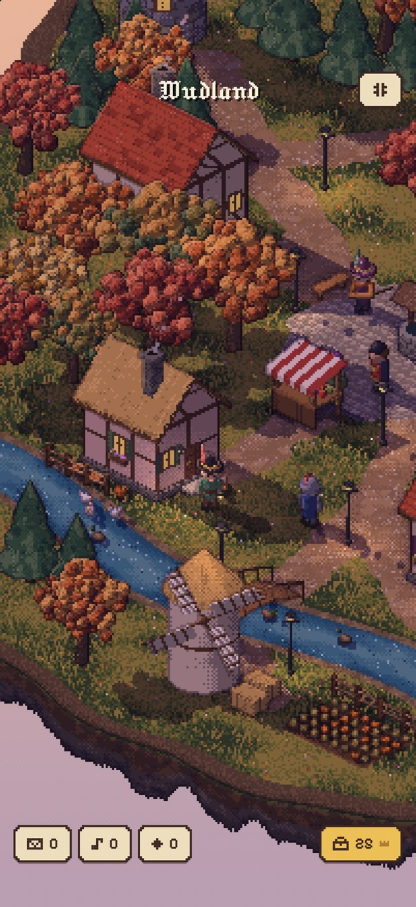
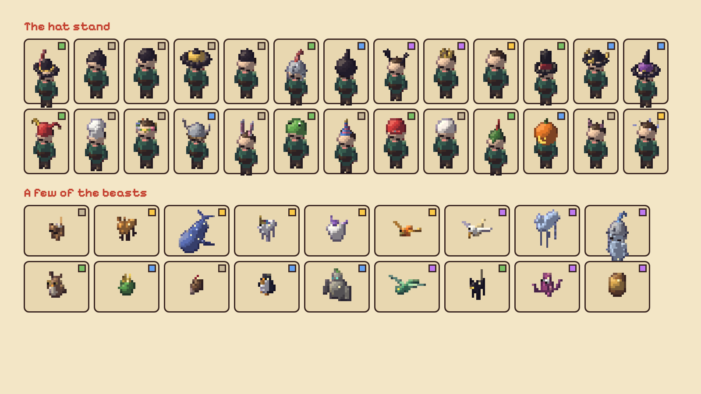
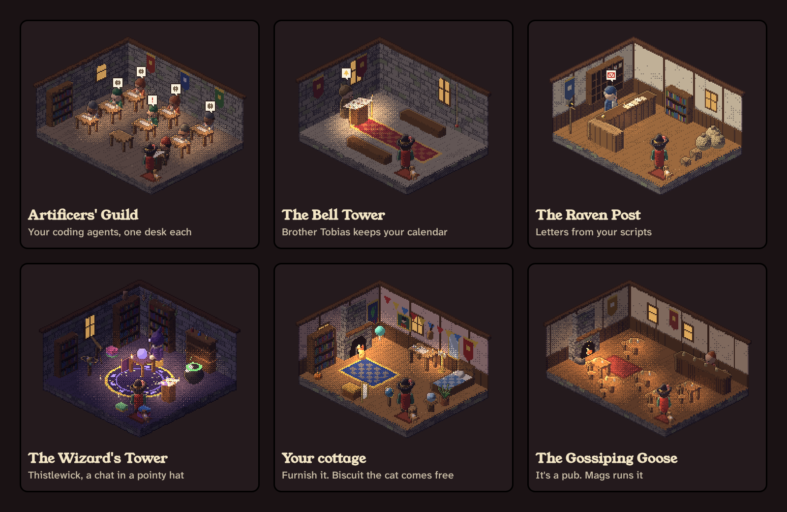
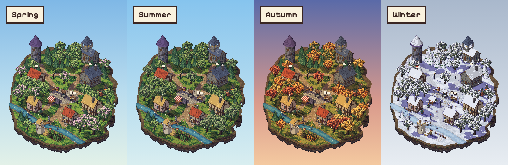

<p align="center">
  
</p>

<h1 align="center">Wudland</h1>

<p align="center">
  Your day, as a little pixel village.<br>
  An iPhone app where your calendar lives in the bell tower and your coding agents turn up for work at the guild.
</p>

<p align="center"><a href="https://wudland.pages.dev"><b>wudland.pages.dev</b></a> · <a href="https://github.com/joexk1/wudland-plugins">Wudland Link (the plugins)</a></p>



## What it is

I wanted a nicer way to see what was going on. A calendar doesn't have to be a grid, and an agent doesn't have to be another terminal tab. So I gave them somewhere to live.

You walk about a small island. Each building looks after one bit of your day, and it only reads that bit once you've said yes. The sky follows the real time, the weather is the weather where you are, and the trees follow the season. There's a wizard to talk to, a cottage to furnish, and some ducks that don't care about your deadlines.

There's no account and no Wudland server. Everything is read on the phone, apart from what your own computer sends it, which is encrypted first.

<table>
  <tr>
    <td width="34%" valign="top">
      
      <p><b>On the phone.</b> Tap the grass to walk, tap a door to go in, tap someone to talk. The counters along the bottom tell you what's new, and the satchel holds your crowns.</p>
    </td>
    <td width="66%" valign="top">
      
      <p><b>The Artificers' Guild.</b> Every agent on a linked computer gets a desk. A cog over the head means it's working, a red <code>!</code> means it's waiting on you or has gone wrong, and the finished ones have a nap at their desks.</p>
      
      <p><b>Hats and beasts.</b> Earn crowns, spend them at Odette's on hats, cloaks, furniture and the odd animal that follows you about.</p>
    </td>
  </tr>
</table>

## Who lives where



| Building | Who's in | What it reads | Where it comes from |
| --- | --- | --- | --- |
| The Bell Tower | Brother Tobias | Your calendar | Apple's EventKit, on the phone |
| The Notice Board | Barnaby the Crier | Your reminders | Apple's EventKit, on the phone |
| The Fields | Old Bram | The weather | Open-Meteo, for your rounded location or a town you type in |
| The Plaza | Fennick the Bard | What you've been listening to | Your music library, on the phone |
| The Artificers' Guild | Master Gearwin | Your coding agents | Wudland Link, end-to-end encrypted |
| The Raven Post | Pim the Postmaster | Letters from your scripts | Wudland Link, end-to-end encrypted |
| The Wizard's Tower | Thistlewick | Only what you say to him | Apple's on-device model, or your own Anthropic or OpenAI key |
| The Cottage | Biscuit the cat | A summary of your day | Everything above, on the phone |
| Odette's Curiosities | Odette the Peddler | Your crowns | Kept in the app |
| The Gossiping Goose | Mags the Barkeep | Nothing at all | It's a pub |

Every permission is optional. Say no to one and that building just has less to say; the rest of the village carries on.

Agent villagers are named after the tool they came from: Claude, Codex, opencode, Antigravity, Bonsai, Terminal for anything wrapped with `wudland run`, and so on. A subagent turns up as Claude's apprentice.



## Linking a computer


1. On the computer, install the command-line tool (Node 18 or newer):

   ```sh
   npm i -g github:joexk1/wudland-plugins
   ```

   If npm refuses with `EALLOWGIT`, add `--allow-git=root` to that command.

2. In Wudland, open **Settings → Link a computer**. It shows a six-digit code that changes every minute. Run it on the computer:

   ```sh
   wudland link 123456
   ```

3. Both screens then show the same eight-digit code. If they match, tap **Codes match**. If they don't, deny it. That check is what stops a relay from quietly swapping the keys.

4. Install the plugin for your agent (below), then run `wudland test-send` to welcome your first neighbour.

You link once per computer, and every agent on it shares that link.

## Plugins

The computer side lives in **[wudland-plugins](https://github.com/joexk1/wudland-plugins)**, under the MIT licence.

| Tool | How it hooks in |
| --- | --- |
| Claude Code | `/plugin marketplace add joexk1/wudland-plugins`, then `/plugin install wudland@wudland` |
| Codex | One `notify` line in `~/.codex/config.toml`, or hooks for live status |
| opencode | Copy `opencode/wudland.js` into `~/.config/opencode/plugin/` |
| Anything else | `wudland run -- <command>`, or `wudland emit` from a script |

Scripts can also post to the Raven Post with `wudland letter "Backup finished" "Copied at 03:00."`.

## Your data

- **No account, no Wudland server.** Calendar, reminders and music are read on the phone after you allow them, and stay there. Saved secrets go in the iOS Keychain.
- **Agent updates and letters are encrypted** with AES-256-GCM before they leave your computer. Pairing uses X25519 and HKDF-SHA256, plus the code you compare on both screens.
- **The relay** is ntfy.sh by default, and you can run your own. It sees IP addresses, timing and the pairing announcements (computer labels and public keys). It can't read the updates or letters.
- **Titles.** An agent's title can include the first 60 characters of its prompt. `wudland config titles off` sends the folder name instead and drops file names from notes.
- **Weather** sends rounded coordinates, or the town you typed, to Open-Meteo.
- **The wizard** runs on the phone where Apple Intelligence is available. If you give him your own cloud key instead, his chat (and only his chat) goes straight to that provider, and their charges and terms apply. Calendar, reminders, location, letters and agent data are never attached.

## Build it

You need a Mac with Xcode 26 or newer, the iOS 26 SDK and [XcodeGen](https://github.com/yonaskolb/XcodeGen).

```sh
brew install xcodegen
xcodegen generate
open Wudland.xcodeproj
```

Pick your own signing team and a unique bundle identifier before running on an iPhone. The project leaves the team unset on purpose.

For a simulator build without signing:

```sh
xcodebuild -project Wudland.xcodeproj -scheme Wudland \
  -sdk iphonesimulator -configuration Debug CODE_SIGNING_ALLOWED=NO build
```

```text
Wudland/
  App/           the app and the village screen
  Local/         permissions, local data, linking, the wizard, storage
  Village/       state and the economy
  Talk/          conversations and villagers
  Game/          the SwiftUI to WebKit bridge
  Web/           the pixel world: generation, rendering, interaction
  UI/            native sheets, theme and sound
  Resources/     bundled fonts
```

The world is drawn by the bundled JavaScript engine inside a WKWebView. The app around it is SwiftUI, EventKit, CoreLocation and CryptoKit.

## Status

The first iPhone release is in App Store review. I'll add the link here once it's out.

**iPhone duo mode: coming soon.**

## Bugs and ideas

[Open an issue](https://github.com/joexk1/wudland/issues). Please take out private calendar details, messages, API keys, link codes and `~/.config/wudland` files before posting anything.

## Licence

Wudland is GPLv3. See [LICENSE](LICENSE). The plugins are MIT, so you can borrow them for your own projects.

Bits that came from elsewhere, with their notices in [THIRD_PARTY_LICENSES](THIRD_PARTY_LICENSES):

- The renderer builds on **Pixel Plays** by AmirMushich, under the MIT licence.
- **Jacquard 12** and **Pixelify Sans** are bundled under the SIL Open Font License 1.1.
- Weather data comes from **[Open-Meteo](https://open-meteo.com)**.
